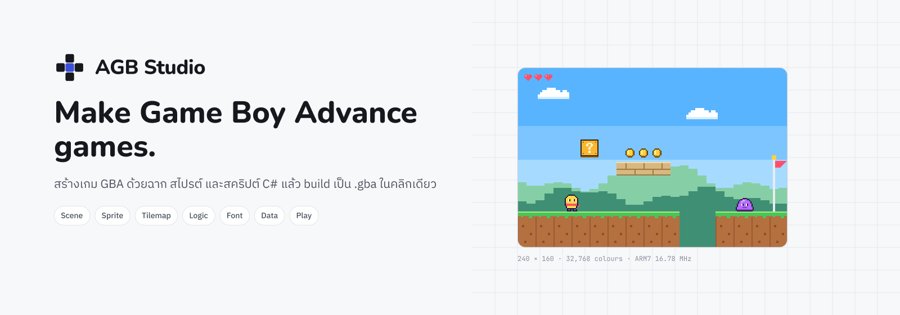

# AGB Studio release notes

## 1.0.0

2026-10-31

The first release: a Windows editor and toolchain for making Game Boy Advance games, with game logic in a C# subset that is translated to C++, Thai and English text, and a runtime engine written for the hardware.

### Highlights
- Thai variable-width fonts
- Logic Graph ⇄ C# sync
- Flash to EZ-Flash / EverDrive

### Editor
- Launcher with recent projects, eight genre templates, five tutorials, four sample projects and links to the documentation.
- Scene Editor with Hierarchy, Inspector, Assets, Console and Animation panels, GBA budget meters, undo and autosave.
- Tilemap Editor (tile, image, rotate / scale and collision-only layers, auto-tile rules), Sprite Editor (PNG and Aseprite files), Palette Manager and Font Manager.
- Database, Localization (fit check against the GBA text box), Dialogue Editor and World Map.
- Audio page with a tracker view and preview, and the SFX Designer for effects on the GBA's DMG sound channels.
- Script Editor with the GAE001-GAE006 rules and quick fixes, the offline Scripting API, and opening scripts in VS Code, Rider or Visual Studio.
- Logic Graph: node graphs that generate C#; generated C# reads back into the graph.
- Build ROM with per-step progress and clickable errors, Build Report with history, and Export ROM (optional padding to a power of two).
- Flash to Cartridge: copies the ROM to a flash cart's SD card; a GBxCart RW is detected and read but not written.
- Play mode in the built-in mGBA core with a live Inspector, play speed, frame step, Console and hot reload of scripts.
- Debugger with profiler, memory, palettes and OAM views and C# breakpoints.
- Dark and light themes, Command Palette (Ctrl+K) and rebindable shortcuts.

### Engine
- Tile, image and rotate / scale layers, including the Mode 7 floor of the Racing template; maps stream as the camera moves.
- Connected scenes: join scenes edge to edge in the World Map and the player walks across with no load.
- Tiles that draw in front of the actors (two-layer metatiles), and a secondary tileset that shares a primary's tiles.
- Save during cutscenes (Project Settings · Save data), and replays: Record in Play Mode, Tools › Run Recorded Tests, `agb test`.
- Bitmap video modes 3, 4 and 5: a scene shows a full-screen picture, and C# scripts draw on it (Bitmap: clear, set pixel, filled rectangle, show a picture, page flip in Modes 4 and 5).
- Slopes, one-way platforms, ladders, hazards and water tiles; built-in behaviours from the Component Picker.
- Up to 64 actors with up to 6 behaviours each, spawning and touches; up to 128 sprites with animation and 32 affine matrices.
- Event Script VM for cutscenes and dialogue: waits, choices, commands and saved flags.
- World Map links of kind On touch, Door (overlap and Up) and Respawn (overlap, or when the player is lost).
- Text in Thai and English (and Japanese kana fonts) with dictionary word wrap, dialogue boxes, choices and HUD labels.
- Menu / UI kit: boot splash, title menus, pause overlay and options (volume, language, button remap).
- Save data on SRAM, Flash or EEPROM with two copies per slot, checksums and autosave.
- Maxmod music (MOD / XM) and WAV sound effects; SFX Designer effects play on the DMG channels with no sample data.
- The build fails with a message when a scene needs more background VRAM or palettes than the GBA has.

### Templates and samples
- Templates: Platformer, Top-down Adventure, Visual Novel, Puzzle, Shoot 'em up, Turn-based RPG, Racing (Mode 7) and Beat 'em up. Automated tests build each one, play it to its end with a bot and fail on any gameplay frame overrun.
- Samples: Sky Hopper demo, Cave Quest, Snow Run and Dusk Story.
- All template and sample art, music and text is original and generated by AGB Studio.

### Licence
- AGB Studio and the runtime inside your games are under the MIT licence; games made with AGB Studio can be sold.
- Every build writes THIRD_PARTY.txt next to the ROM with the notices of the AGB Studio runtime, libtonc and maxmod; ship it with your game (see docs/user/licence-for-your-games.md).

### Known limits
- Windows 10 and 11 (x64) only; devkitPro must be installed separately (the editor finds it or explains how).
- Builds are not code-signed (D-19): Windows SmartScreen may ask before the first start.
- Check for Updates and Report a Bug use the addresses in editor.json; with none set they say so (D-13).
- Writing to a GBxCart RW cartridge is turned off until it has been verified on hardware.
- Scenes in Video Modes 3, 4 and 5 show a picture and sprites only: the frame buffers fill the memory for map layers, text and menus, so the build warns and those do not show. Use Mode 0, 1 or 2 for a scene with text.
- OpenType variable fonts (CFF2 outlines), font collections (.ttc) and web fonts (.woff) are refused: use a static .otf or .ttf, BDF or an image sheet.
